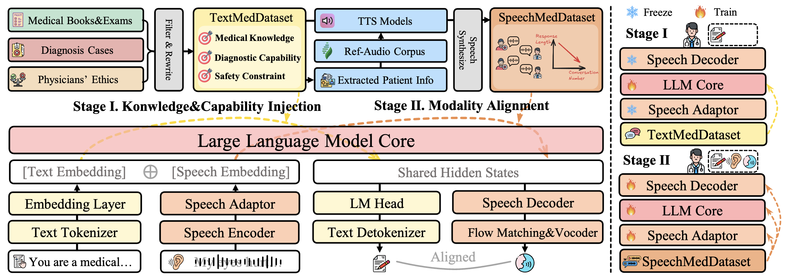

> Accepted by **ACL 2026** Main Conference (Long Paper)



**作者：** 陈思远，王洁怡，陈伟，魏忠钰（复旦大学 · 北京大学 · 华中科技大学）

- 论文：[[ACL Anthology]](https://aclanthology.org/2026.acl-long.1428/) · [[arXiv]](https://arxiv.org/abs/2601.04638) · [[PDF]](https://aclanthology.org/2026.acl-long.1428.pdf)
- 代码 & 模型权重：[[GitHub]](https://github.com/SirryChen/SpeechMedAssist)
- 交互 Demo：[[语音样例 Demo](https://sirrychen.github.io/blogs/2025-09-22-SpeechMedAssist.html)]
- 原文推送：[[微信公众号]](https://mp.weixin.qq.com/s/2bx3dmaVIsT6cP6h4UzE4A)

---

## 1. 引言
{: id="引言"}

在现实生活中，真实的医疗咨询是基于**语音对话**进行的。语音中除了患者的主诉外，还包含大量**副语言信息**——例如咳嗽、停顿、犹豫等，这些往往是诊断的重要线索。然而，当前大多数医疗大模型仍然停留在**长文本问答**的范式中：患者需要一次性输入完整症状，模型再输出冗长的诊断说明。

这种交互方式与真实门诊流程存在结构性错位。对老年人、低识字用户或非专业患者而言，打字本身就是一道门槛；更重要的是，文本无法自然承载语音中蕴含的节奏与副语言信号。

我们提出的 **SpeechMedAssist**，是一个原生支持**语音多轮医疗咨询**的 SpeechLM（Speech Language Model）。它可以直接「听」患者说话、「说」出回复，并在对话中完成症状分析、主动追问与诊疗建议。论文已被 **ACL 2026** 主会长文录用。

---

## 2. 为什么医疗咨询应该以语音交互为主？
{: id="为什么医疗咨询应该以语音交互为主"}

医疗咨询从来不是一个「信息一次性输入、答案一次性输出」的过程。

在真实场景中，患者往往只能给出**模糊、片段化**的症状描述，而医生需要通过**多轮追问**逐步澄清关键信息，最终形成诊断与建议。文本医疗模型通常假设患者能够一次性、完整、准确地描述症状——但这一假设在真实世界里往往不成立。

相比之下，基于语音的医疗咨询在交互形态上更贴近真实诊疗流程：

- 患者通过自然语音**逐步描述**症状，模型能够**主动追问**与动态引导
- 交互对更广泛人群友好，并能捕捉**副语言信息**（如咳嗽声）
- 咨询过程呈现为**连续、多轮**的对话，而非「填空式输入」

---

## 3. 直接用语音大模型做医疗咨询，难在哪里？
{: id="直接用语音大模型做医疗咨询难在哪里"}

尽管语音交互在形式上更自然，但让模型「会说话」并不等于「会看病」。直接使用现有 SpeechLM 做医疗咨询，面临三大挑战：

| 挑战 | 说明 |
|------|------|
| **医学知识不足** | 现有语音大模型大多训练于通用数据，缺乏系统的医学知识结构 |
| **临床对话能力缺失** | 医疗咨询强调逐步信息获取、主动追问等专业技巧，对对话策略要求更高 |
| **医疗语音数据极度稀缺** | 直接依赖语音数据学习医学能力，成本高、效率低，且难以规模化 |

正因如此，如何在不依赖大规模真实医疗语音数据的前提下，构建真正可用的语音医疗大模型，仍是一个开放问题。

---

## 4. 我们的思路：解耦「知识学习」与「模态对齐」
{: id="我们的思路解耦知识学习与模态对齐"}

SpeechMedAssist 的核心思想很简单，但非常关键：

> **语音大模型既可以从语音中学习，也可以从文本中学习。**

SpeechLM 将语音与文本编码到**共享的语义空间**中。因此，我们可以把传统「纯语音一阶段微调」解耦为两阶段训练范式：

1. **Stage I — 知识与能力注入（文本）**：用大规模医学文本，高效注入医学知识与临床对话能力
2. **Stage II — 模态重对齐（少量语音）**：用极少量合成医学语音，重新对齐语音与文本模态

这一设计将对医疗语音数据的需求降低至仅需 **1 万条**合成样本，即可实现有效的模态对齐。

### 4.1 Stage I：用文本高效注入医学知识与诊疗能力
{: id="stage-i用文本高效注入医学知识与诊疗能力"}

在第一阶段，我们**冻结**语音大模型中所有语音相关模块（语音编码器、适配器、解码器等），**仅训练 LLM 核心**，让模型通过大规模医学文本学习：

- 医学知识（疾病、用药、检查）
- 临床推理能力
- 医疗安全与伦理边界
- 多轮问诊结构与主动追问能力

为此，我们构建了 **TextMedDataset（405k）**，涵盖医学考试、百科问答、多轮问诊和安全约束数据，覆盖 49 个临床科室。

### 4.2 Stage II：用少量语音数据重新对齐模态
{: id="stage-ii用少量语音数据重新对齐模态"}

文本「学会了」，但模型还需要「说得出来」。

第二阶段，我们使用极少量医学语音数据对模型进行模态重对齐：

- 对齐语音与文本的共享语义空间
- 学会在语音输入下正确调用已掌握的医学能力
- 提升语音生成的自然度与一致性

实验表明：**仅 10k 条合成医学语音，就足以完成有效对齐**，性能接近使用 198k 全量语音数据训练的模型。

---

## 5. 数据怎么来？「重写 + 合成」流水线
{: id="数据怎么来重写--合成流水线"}

为了支撑两阶段训练，我们设计了一套可扩展的数据构建流程：

1. **文本重写**：将冗长、单轮的医学问答，重写为贴近真实问诊流程的多轮对话（平均 6.58 轮，每轮约 36.4 字，每段对话约 3.3 次追问）
2. **患者属性建模**：自动推断患者的性别、年龄段
3. **条件语音合成**：
   - 患者属性明确 → 使用 CosyVoice2 + 2000 余真实说话人参考音频（来自 Aishell2/3，约 1000h）
   - 患者信息缺失 → 使用 FishSpeech 随机音色

最终构建 **SpeechMedDataset（198k）**，覆盖多轮、真实风格的医学语音对话。

| 数据集 | 用途 | 规模 |
|--------|------|------|
| CMB-Exam / 医学百科 / 医学书籍 | 医学知识注入 | 270k |
| CMtMedQA / MedDG / HuatuoGPT2-SFT | 诊断能力训练 | 132k |
| MedSafety-GPT4 | 安全约束 | 450 |
| SpeechMedDataset | 模态重对齐 | 198k |

---

## 6. 怎么评测「语音医疗模型」？SpeechMedBench
{: id="怎么评测语音医疗模型speechmedbench"}

现有评测要么只看医学问答，要么只看语音质量，但真实医疗咨询**两者缺一不可**。我们设计了 **SpeechMedBench**，从四个维度系统评测：

| 维度 | 内容 |
|------|------|
| **医学知识与安全性** | 单轮 Q&A（CMB、CME、百科、MedSafety） |
| **多轮问诊能力** | 模拟真实患者（MedDG / AIHospital 驱动） |
| **真实环境鲁棒性** | Wild：20 组真实临床环境录音，含噪声与口语化表达 |
| **语音质量与延迟** | UTMOS 自然度、ASR-CER 一致性、首包延迟 |

在几乎所有评测设置中，SpeechMedAssist 都显著优于：

- 级联系统（ASR + 医疗 LLM + TTS）
- 通用 SpeechLM（Kimi-Audio、GLM4-Voice、SpeechGPT2 等）
- 多模态 Omni 模型（Qwen2.5-Omni、BaichuanOmni 等）

**主要结果（语音交互评测）：**

| 模型 | CMB↑ | MedDG↑ | AIHospital↑ | Wild 投票↑ |
|------|------|--------|-------------|-----------|
| HuatuoGPT2+ASR+TTS | 60.39 | 79.25 | 80.70 | 20 |
| GLM4-Voice | 35.14 | 80.81 | 80.43 | 12 |
| Qwen2.5-Omni | 76.83 | 76.46 | 76.53 | 1 |
| **SpeechMedAssist** | **77.96** | **83.26** | **83.40** | **26** |

此外，SpeechMedAssist 还展现出：

- **噪声鲁棒性**：在 babble 噪声 CER=0.2~0.6 下性能下降显著小于基线
- **副语言感知**：对咳嗽等非语言信号的有效感知（感知率 57.2%）
- **语音质量**：输出自然度接近 TTS 模型，延迟表现优异
- **回复简洁**：平均回复长度约 51 字，更贴近真实门诊交流节奏

---

## 7. 真实场景示例
{: id="真实场景示例"}

以下是一段来自 **Wild** 评测集的真实患者语音咨询（含背景噪声与口语化表达）。SpeechMedAssist 能够结合患者病史给出针对性回复，并进行主动追问：

<div class="demo-wild-container">
  <div class="demo-wild-card">
    <div class="demo-wild-row">
      <span class="demo-wild-role">Patient</span>
      <div class="demo-wild-content">
        <div class="demo-wild-text">就是2月份咨询过的噢，因为当时是输卵管已经做过手术后，今天4月又怀孕了一次，左右都有了，双侧输卵管切除，今年4月份又搞了一次宫外孕。我现在想去做检查，想做试管了。医生，宫外孕的原因是什么？</div>
        <audio preload="none" controls class="demo-wild-audio"><source src="/file/SMD/wild/wav_compress/patient/20250920_115710.mp3" type="audio/mp3"></audio>
      </div>
    </div>
    <div class="demo-wild-row">
      <span class="demo-wild-role">SpeechMedAssist</span>
      <div class="demo-wild-content">
        <div class="demo-wild-text">输卵管妊娠就是受精卵没在子宫里着床，而是在输卵管里。这通常是因为输卵管有阻塞或者炎症，影响了受精卵的正常移动。你之前有过输卵管手术和宫外孕经历，这些都增加了风险。你现在想再试一次，但最好先做全面检查，看看输卵管情况如何。</div>
        <audio preload="none" controls class="demo-wild-audio"><source src="/file/SMD/wild/wav_compress/wav_SpeechMedAssist2/0/doctor_0.mp3" type="audio/mp3"></audio>
      </div>
    </div>
  </div>
</div>

更多模型对比样例（Wild / Single QA / Multi Conv）请见 **[交互 Demo 页面](/blogs/2025-09-22-SpeechMedAssist.html)**。

---

## 8. 为什么这种方法有效？
{: id="为什么这种方法有效"}

通过系统消融实验，我们发现：

1. **直接用语音学医学，是低效且不稳定的** —— 纯语音训练在医学知识与多轮对话上均显著落后
2. **两阶段训练是必要且有效的** —— Stage I 注入知识与能力，Stage II 恢复并进一步提升语音模态表现
3. **模态重对齐只需 10k 量级语音数据** —— 性能增益在前 5k 步最为显著，之后趋于饱和

SpeechMedAssist 证明了一件事：

> 将语音大模型应用到医疗等垂直领域，**不需要大量的垂域语音数据**。可以将其解耦为基于大量文本数据的「知识学习」和基于少量语音数据的「模态重对齐」。

我们希望这项工作能为 SpeechLM 在**低资源垂直领域**的落地提供一个可复用的范式。

---

## 9. 引用
{: id="引用"}

如果您觉得这项工作对您有帮助，欢迎引用：

```bibtex
@inproceedings{chen2026speechmedassist,
  title={SpeechMedAssist: Efficiently and Effectively Adapting Speech Language Models for Medical Consultation},
  author={Chen, Sirry and Wang, Jieyi and Chen, Wei and Wei, Zhongyu},
  booktitle={Proceedings of the 64th Annual Meeting of the Association for Computational Linguistics (Volume 1: Long Papers)},
  pages={30914--30935},
  year={2026}
}
```
